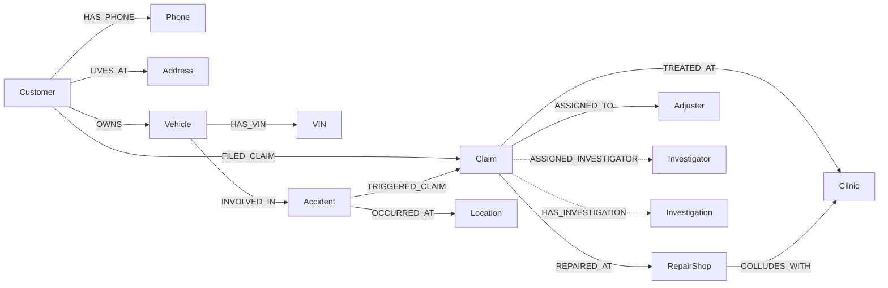
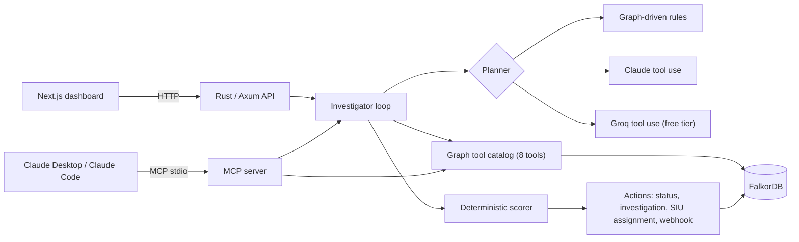

# Diktiax

**An investigation agent that finds insurance fraud rings by walking a FalkorDB graph, then acts on what it finds.**

Track 01, Agents That Act on Connected Data: FalkorDB "Graph Hacks: Context for AI Agents".

Demo video: _link coming_ · Live demo: _link coming_

## The problem

An SIU (Special Investigation Unit) analyst reviews claims one at a time. Organized fraud doesn't show up that way. Claim CLM-48291 is an ordinary $42,500 collision on its own. What gives it away is everything around it:

- two other claims had accidents at the same intersection, with no police report
- all three were repaired at the same body shop and treated at the same clinic
- all three were handled by the same adjuster
- two of the claimants share a phone number

None of that lives in any single record, and a vector search over claim text can't find it either: it returns claims that *read* alike, not claims that are *connected*. In a graph, each of those signals is one short traversal.

## What Diktiax does

Give it a claim id. The agent:

1. **Explores** the claim's neighbourhood in FalkorDB (3 hops).
2. **Decides which detectors to run** based on what that neighbourhood contains. A detector whose pattern can't possibly match is skipped.
3. **Runs Cypher detectors** for four fraud-ring patterns, then follows the evidence: shops named in a match get a centrality check, and linked claims get corroborated.
4. **Scores** the claim from detector results only. The LLM never sets the score.
5. **Acts**: writes the new claim status and an `Investigation` node back to the graph, freezes the payout, assigns an SIU investigator picked from the graph by specialty and workload, and optionally fires a webhook.

Every step is returned as a trace: tool, arguments, why it was chosen, what came back, and how long it took.

## How the graph drives the agent

Real runs with the rule-based planner (`cargo run --release -- --investigate <id>`):

**CLM-48291 (ring member): 8 tool calls → risk 100, CRITICAL_FRAUD, payout frozen, investigator assigned**

| # | Tool | Why the planner chose it | Result |
|---|------|--------------------------|--------|
| 1 | `explore_claim_subgraph` | Map the neighbourhood first | 24 nodes, 32 edges |
| 2 | `detect_ghost_collision` | LOC-441 hosts several accidents; claim repaired at SHOP-801 | match, +45 |
| 3 | `detect_shared_contacts` | Phone +1-555-019-8821 belongs to more than one customer | match, +25 |
| 4 | `detect_vin_cloning` | A VIN is in the neighbourhood | no match |
| 5 | `detect_kickback_triangle` | No police report; ADJ-04 and MED-201 attached | match, +40 |
| 6 | `shop_centrality` SHOP-801 | SHOP-801 appears in the fraud evidence | 1.71× the average shop, anomalous |
| 7-8 | detectors on CLM-39102 | Linked to CLM-48291 through the shared phone | match (corroboration, not scored) |

**CLM-10022 (clean claim): 3 tool calls → risk 0, cleared automatically**

The planner explores, runs two detectors, and stops. It never calls `detect_shared_contacts` (no phone or address is shared) or `detect_kickback_triangle` (there's a police report and no clinic). Different graph, different investigation.

## Graph data model

Source of truth: [`data/seed.cypher`](data/seed.cypher) (68 nodes, 84 relationships) and the ingest/write-back queries in [`backend/src/db/queries.rs`](backend/src/db/queries.rs).



Dashed relationships are written by the agent.

| Label | Key properties | Why it's a node |
|-------|----------------|-----------------|
| `Claim` | `id`, `amount_claimed`, `status`, `filed_day` | The thing under investigation; `status` is overwritten by the agent |
| `Customer` | `id`, `name` | Claimant |
| `Phone`, `Address` | `number`, `line` | Merged on value, so customers who share one share the node: a shared contact is a graph path, not a string comparison |
| `Vehicle`, `VIN` | `id`, `jurisdiction`; `vin` | One `VIN` node with two vehicles pointing at it is the cloning signal |
| `Accident`, `Location` | `police_report_filed`; `id` | Where and how the loss happened |
| `RepairShop`, `Clinic`, `Adjuster` | `id`, `name` | The service providers that rings reuse |
| `Investigator` | `specialties`, `open_cases` | Seeded SIU staff the agent assigns from |
| `Investigation` | `decision`, `risk_score`, certificate id | The agent's recorded verdict |

Seeded scenarios: a ghost-collision ring (CLM-48291, CLM-39102, CLM-44730), a cloned-VIN pair across CA and NV (CLM-55104, CLM-31205), and three clean controls (CLM-10022, CLM-20417, CLM-20988).

## The Cypher queries

All detectors live in [`backend/src/db/queries.rs`](backend/src/db/queries.rs). Every value is passed as a parameter. Each one returns the node ids that form the evidence path.

**Ghost collision ring**: other claims at the same location, repaired at the same shop, within 90 days.

```cypher
MATCH (c:Claim {id: $claim_id})<-[:TRIGGERED_CLAIM]-(:Accident)-[:OCCURRED_AT]->(loc:Location),
      (c)-[:REPAIRED_AT]->(shop:RepairShop),
      (loc)<-[:OCCURRED_AT]-(:Accident)-[:TRIGGERED_CLAIM]->(other:Claim)-[:REPAIRED_AT]->(shop)
WHERE other.id <> c.id AND abs(other.filed_day - c.filed_day) <= $window_days
RETURN c.id AS claim_id, loc.id AS location_id, shop.id AS shop_id,
       other.id AS linked_claim_id, abs(other.filed_day - c.filed_day) AS days_apart
```

**Shared contact network**: claimants of other claims who share this claimant's phone or address.

```cypher
MATCH (c:Claim {id: $claim_id})<-[:FILED_CLAIM]-(me:Customer)-[link:HAS_PHONE|LIVES_AT]->(contact)
      <-[:HAS_PHONE|LIVES_AT]-(peer:Customer)-[:FILED_CLAIM]->(other:Claim)
WHERE peer.id <> me.id
RETURN c.id AS claim_id, me.id AS customer_id, type(link) AS via,
       coalesce(contact.number, contact.line) AS contact, peer.id AS peer_id,
       peer.name AS peer_name, other.id AS linked_claim_id
```

**Cloned VIN**: other vehicle registrations carrying the same VIN that also produced claims.

```cypher
MATCH (c:Claim {id: $claim_id})<-[:TRIGGERED_CLAIM]-(:Accident)<-[:INVOLVED_IN]-(v:Vehicle)-[:HAS_VIN]->(vin:VIN)
      <-[:HAS_VIN]-(clone:Vehicle)-[:INVOLVED_IN]->(:Accident)-[:TRIGGERED_CLAIM]->(other:Claim)
WHERE other.id <> c.id
RETURN c.id AS claim_id, v.id AS vehicle_id, v.jurisdiction AS jurisdiction, vin.vin AS vin,
       clone.id AS clone_vehicle_id, clone.jurisdiction AS clone_jurisdiction, other.id AS linked_claim_id
```

**Kickback triangle**: an unreported accident whose adjuster, shop and clinic recur together on other claims.

```cypher
MATCH (a:Accident)-[:TRIGGERED_CLAIM]->(c:Claim {id: $claim_id}),
      (c)-[:REPAIRED_AT]->(shop:RepairShop), (c)-[:TREATED_AT]->(clinic:Clinic), (c)-[:ASSIGNED_TO]->(adj:Adjuster),
      (other:Claim)-[:REPAIRED_AT]->(shop), (other)-[:TREATED_AT]->(clinic), (other)-[:ASSIGNED_TO]->(adj)
WHERE other.id <> c.id AND a.police_report_filed = false
OPTIONAL MATCH (shop)-[ref:COLLUDES_WITH]->(clinic)
RETURN c.id AS claim_id, adj.id AS adjuster_id, shop.id AS shop_id, clinic.id AS clinic_id,
       other.id AS linked_claim_id, ref IS NOT NULL AS referral_link
```

**Shop concentration** (degree centrality): a shop's claim count against the average across all shops. 1.5× or more is flagged.

```cypher
MATCH (s:RepairShop) OPTIONAL MATCH (s)<-[:REPAIRED_AT]-(c:Claim)
RETURN s.id AS shop_id, s.name AS shop_name, count(c) AS degree
```

## Why you can trust the verdict

- **Planners only choose which graph tools to call.** The score is computed by `FraudRiskEvaluator` ([`domain/evaluator.rs`](backend/src/domain/evaluator.rs)) from detector results on the target claim, capped at 100.
- **An LLM can't clear a claim by skipping checks.** With the Claude or Groq planner, any detector it didn't run is executed before scoring. Its closing text is labelled "not used for scoring".
- **Bounded:** the planner gets at most 12 tool calls; the coverage guard can add up to 4 detector runs after that. If the LLM API fails, the rule-based planner takes over and the dossier says so (`planner: rule-based (fallback: groq:... failed: ...)`).
- **Never cleared on bad data:** if exploring the claim or any detector on it fails, the score is only a lower bound (missing detectors can only add points). A bound that already reaches HIGH or CRITICAL still freezes the payout; anything lower becomes `INCONCLUSIVE` with status `NEEDS_MANUAL_REVIEW`, and the failed calls are named in the rationale. Only an exact `LOW_RISK` result clears a claim.
- **Checkable:** each investigation returns a certificate with a SHA-256 digest over the claim id and the ordered steps, so a saved dossier can be re-hashed later to spot edits (the server doesn't store or verify it yet). Each detector step carries the Cypher that produced it.

## Does the graph matter? (measured)

[`backend/tests/baseline.rs`](backend/tests/baseline.rs) runs classic single-claim red-flag rules (no police report, or amount ≥ $25,000, reading only the claim and its own accident) against the graph agent. It uses the seeded claims plus two constructed groups: ring members who file police reports and keep amounts small, and honest drivers whose claims carry red flags.

| Group | Claims | Per-claim rules flagged | Graph agent flagged |
|---|---|---|---|
| Seeded fraud (ring + cloned VIN) | 5 | 5/5 | 5/5 |
| Seeded clean controls | 3 | 0/3 | 0/3 |
| Evasive ring members (police report, small amounts) | 3 | 0/3 | 3/3 |
| Honest claims with red flags (no police / high amount) | 2 | 2/2 | 0/2 |

Fraud caught: rules 5/8, graph 8/8. Honest claims flagged: rules 2/5, graph 0/5. Rules catch careless fraud; the graph also catches organised fraud that learned the rules, because the ring still reuses its phone, crash location and body shop. The groups are small and constructed, so read this as a demonstration of the mechanism, not an accuracy benchmark.

```bash
cd backend && cargo test --test baseline -- --ignored --nocapture
```

Query latency, from [`scripts/bench_queries.py`](scripts/bench_queries.py): FalkorDB's server-side execution time, 200 runs after 10 warm-ups, FalkorDB v4.22.1 in Docker on a laptop, demo graph (68 nodes):

| Query (on CLM-48291) | Median ms | p95 ms | Max ms |
|---|---|---|---|
| `explore_claim_subgraph` (3 hops) | 0.073 | 0.109 | 0.165 |
| `detect_ghost_collision` | 0.141 | 0.168 | 0.260 |
| `detect_shared_contacts` | 0.122 | 0.143 | 0.191 |
| `detect_vin_cloning` | 0.126 | 0.151 | 0.248 |
| `detect_kickback_triangle` | 0.157 | 0.187 | 0.265 |
| `shop_centrality` | 0.048 | 0.071 | 0.162 |

## Architecture



The agent, the HTTP API and the MCP server all use the same tool catalog. Claude Desktop calls exactly the tools the agent calls.

- **Backend:** Rust (Axum, Tokio, `falkordb` crate). FalkorDB is the only database.
- **Frontend:** Next.js 16 / React 19, with the agent trace timeline, a live graph canvas and a claim intake form.
- **Planner:** graph-driven rules by default; Claude (Anthropic Messages API tool use) when `ANTHROPIC_API_KEY` is set, otherwise any OpenAI-compatible chat-completions model (Groq by default) when `GROQ_API_KEY` is set. LLM failures fall back to the rules, and detectors the model skipped still run before scoring.

## Run it locally

Prerequisites: Docker, Rust (stable), bun.

```bash
docker compose up -d falkordb                     # FalkorDB on localhost:6379
cd backend && cargo run --release                 # API on :3001, seeds an empty graph
cd frontend && bun install && bun run dev         # dashboard on :3000 (second terminal)
```

Open http://localhost:3000, pick a claim and investigate it. To see detection on a claim nobody scripted, file a new one with phone `+1-555-019-8821`, location `LOC-441` and shop `SHOP-801`.

Command line:

```bash
cd backend
cargo run --release -- --investigate CLM-48291    # prints the full dossier as JSON
cargo run --release -- --seed                     # reset the graph (investigations write to it)
cargo test                                        # unit tests
cargo test -- --ignored                           # integration tests against live FalkorDB
```

Everything in containers: `docker compose -f docker-compose.full.yml up --build`, then open http://localhost:3000.

Optional environment (see [`.env.example`](.env.example)): `ANTHROPIC_API_KEY` switches to the Claude planner; without it, `GROQ_API_KEY` enables a free LLM planner on Groq (`GROQ_MODEL` overrides `openai/gpt-oss-120b`, `LLM_BASE_URL` points it at another OpenAI-compatible endpoint such as OpenRouter, Gemini or Ollama); `WEBHOOK_URL` receives escalations, and `FALKORDB_URL` / `FALKORDB_GRAPH` point at another FalkorDB.

## Use it from Claude (MCP)

```bash
cd backend && cargo build --release
claude mcp add diktiax -e FALKORDB_URL=falkor://127.0.0.1:6379 -- "$PWD/target/release/claimgraph-backend" --mcp-server
```

This exposes the 8 read-only graph tools plus `investigate_claim`, which runs the full agent and **writes to the graph**. For Claude Desktop, use the same command and args in `claude_desktop_config.json`.

## Deploy

The backend runs on Render's free tier and the frontend on Vercel.

**Render, one container.** [`deploy/render/Dockerfile`](deploy/render/Dockerfile) packs FalkorDB (Redis + module, bound to loopback) and the backend into one image. The graph is in memory and re-seeded on every start, so a sleep or restart always comes back to the complete demo graph. On Render: New Web Service → this repo → Docker, Dockerfile path `deploy/render/Dockerfile`, instance type Free, health check `/api/health`, environment `GROQ_API_KEY`, `GROQ_MODEL`, `ADMIN_TOKEN`. Free services sleep after 15 minutes idle; an uptime pinger on `/api/health` every 10 minutes keeps it awake, and the dashboard waits up to 70 s for a cold start.

**Vercel:** project root `frontend/`, install command `bun install`, and `NEXT_PUBLIC_API_BASE=https://<render-domain>` set *before* building (it's inlined at build time).

The deployed demo is deliberately open: anyone can file and investigate claims on the synthetic graph. Only `POST /api/seed`, which wipes the graph, is locked, and it fails closed: it needs a matching `x-admin-token` header, and is refused outright if `ADMIN_TOKEN` isn't set (unless `DIKTIAX_DEV=1`, which `make run-backend` sets for local runs). Locally, Docker publishes every port on `127.0.0.1` only.

## API

| Endpoint | Purpose |
|----------|---------|
| `GET /api/claims` · `POST /api/claims` | List claims · file a new claim |
| `POST /api/investigate/:id` | Run the agent; returns score, trace, certificate, actions taken and subgraph |
| `GET /api/graph/:id` | Subgraph for the canvas |
| `GET /api/mcp/tools` · `POST /api/mcp/call` | The graph tool catalog over HTTP |
| `POST /api/seed` · `GET /api/health` | Reset the demo graph (needs `x-admin-token`; local dev: `DIKTIAX_DEV=1`) · health check |

## Limitations

- The data is synthetic and small (68 nodes). This shows the approach, not production scale.
- Detector severity uses fixed thresholds, not learned weights.
- The Claude and Groq planners' request handling is unit-tested; live LLM API calls are not part of the automated tests.
- The ghost-collision window is 90 days, so newly filed claims stop matching the seeded ring once its dates age out.

## AI usage disclosure

Developed with Claude Code as a coding assistant. The architecture, graph model, fraud patterns and scoring rules are my own design, and every result in this README was verified against a live FalkorDB.
